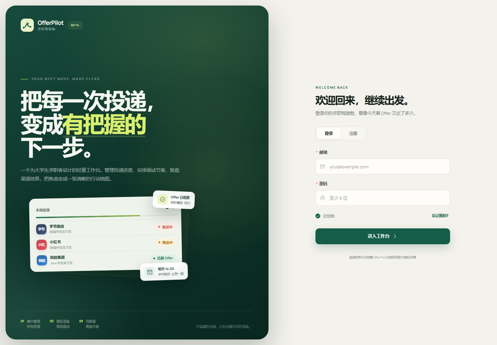

# OfferPilot · 求职驾驶舱

> 把每一次投递，都变成有把握的下一步。

OfferPilot 是一个面向大学生求职者的投递管理平台。它把散落在 Excel、备忘录和聊天记录里的求职进度，收进一个可视化的看板：投递流转、面试日程、简历版本、渠道分析和每周目标都在一个工作台里完成。

这个仓库**只有前端**：Vue 3 页面、组件、路由、状态管理和 Axios 接口层。后端、数据库、建表和业务数据都由你自己使用 Spring Boot + MySQL 完成。

> 仓库不包含 Mock 数据、不包含后端 Java 代码，也不会自动创建数据库。  
> 页面中的数据全部来自你的 Spring Boot 后端。

登录页设计预览：



---

## 前端负责什么

- 页面渲染、布局、交互和动画
- 表单、弹窗、看板拖拽、日历、图表
- 登录态展示、路由守卫、Token 存储
- 通过 Axios 调用 `/api` 接口
- 根据后端返回的数据展示列表、空状态和错误状态

前端**不负责**：

- 用户注册、登录、JWT 签发
- 数据库建表和数据持久化
- 投递、面试、简历的业务规则
- Dashboard / Analytics 的统计计算

---

## 功能页面

- **工作台**：本周目标、关键指标、14 天投递趋势、转化漏斗、近期面试、今日待办
- **投递管理**：看板 / 列表双视图、拖拽更新状态、搜索筛选、标签、备注、下次跟进
- **面试日程**：月历、当日安排、面试准备清单、状态记录、会议链接
- **简历库**：多版本简历、默认版本、文件上传、岗位定向版本
- **数据分析**：渠道表现、状态分布、投递节奏、反馈速度、周期对比
- **个人设置**：资料、求职目标、周投递目标、主题、密码

---

## 技术栈

| 层 | 选型 |
| --- | --- |
| 框架 | Vue 3.5 + TypeScript |
| 构建 | Vite 7 |
| 路由 | Vue Router 4 |
| 状态 | Pinia |
| UI | Element Plus + 自定义设计系统 |
| 图表 | 原生 SVG 自绘 |
| 日期 | Day.js |
| 请求 | Axios |
| 字体 | Manrope Variable（本地打包，无外部 CDN） |
| 数据 | Spring Boot REST API |

设计方向是“安静的求职工作台”：暖纸色背景、深绿侧栏、衬线感数字与克制的动效。没有使用现成后台模板，页面、图表、看板和弹窗均为自定义实现。

---

## 快速开始

环境要求：Node.js 20.19+（建议 22+）。

```bash
npm install
npm run dev
```

打开 `http://127.0.0.1:5173`。

**前端启动后不会自带数据。** 登录、投递、面试、简历等页面都需要你的 Spring Boot 后端已经运行，并且已经实现对应接口。

生产构建：

```bash
npm run build
npm run preview
```

类型检查：

```bash
npm run typecheck
```

---

## 前后端联调

`.env.development` 已经配置为调用真实接口：

```dotenv
VITE_API_BASE_URL=/api
VITE_PROXY_TARGET=http://localhost:8080
```

Vite 会把 `/api` 代理到 Spring Boot：

```ts
// vite.config.ts
server: {
  port: 5173,
  proxy: {
    '/api': {
      target: env.VITE_PROXY_TARGET || 'http://localhost:8080',
      changeOrigin: true,
    },
  },
}
```

生产部署时，把 `VITE_API_BASE_URL` 设为后端完整地址，或让 Nginx 把 `/api` 反向代理到 Spring Boot。

### 推荐联调顺序

```text
1. 注册 / 登录 / GET /auth/me
2. GET /applications，先返回空列表也可以
3. GET /interviews，先返回空列表也可以
4. GET /dashboard
5. 前端登录页联调
6. 投递增删改查 + 拖拽状态
7. 面试、简历上传
8. Analytics
```

不要在后端只完成注册时就期待整个工作台正常显示。登录成功后，工作台会请求 `/applications`、`/interviews`、`/dashboard`，这些接口没实现时页面会显示错误或空状态，这是正常的。

### 响应格式

前端同时兼容两种：

```json
{
  "code": 1,
  "msg": "success",
  "data": {}
}
```

```json
{
  "id": "1",
  "name": "林知遥"
}
```

推荐使用统一包装，前端 Axios 会自动解包。字段、错误码和日期格式见接口文档。

---

## 接口与后端资料

- [后端从 0 开始步骤](docs/BACKEND_FROM_ZERO.md) — 按阶段推进的实施路线与排期
- [登录后的功能模块规划](docs/MODULE_PLAN.md) — 下一步先做什么、每个模块的验收标准
- [后续模块接口速查](docs/API_MODULES.md) — 投递、面试、简历、Dashboard、Analytics
- [注册功能 Controller→Service→Mapper](docs/REGISTER_CONTROLLER_FIRST.md) — 按指定顺序开发注册接口
- [注册接口手把手](docs/REGISTER_STEP_BY_STEP.md) — 从建库到 curl 验收
- [认证模块接口文档（统一响应格式）](docs/API_AUTH_DOC.md) — 注册、登录、当前用户、资料、密码
- [认证模块详细说明](docs/API_AUTH.md) — 直出格式与 curl 自测
- [完整接口文档](docs/API.md) — 字段、枚举、错误码、聚合口径
- [OpenAPI 3.0](docs/openapi.yaml) — 可导入 Apifox / Postman / Swagger
- [数据库结构](docs/schema.sql) — MySQL 8 建表脚本
- [Spring Boot 落地指南](docs/BACKEND_GUIDE.md) — JWT、分页、聚合、文件上传、验收清单

`docs/schema.sql` 只是参考脚本，**不会自动执行**。需要你自己在 MySQL 中运行。

---

## 目录结构

```text
.
├── docs/
│   ├── API.md                          # 完整接口文档
│   ├── API_AUTH_DOC.md                 # 认证接口（统一响应格式）
│   ├── API_AUTH.md                     # 认证接口详细说明
│   ├── BACKEND_FROM_ZERO.md            # 从 0 开始写后端
│   ├── REGISTER_CONTROLLER_FIRST.md    # 注册功能分层开发
│   ├── REGISTER_STEP_BY_STEP.md        # 注册接口完整步骤
│   ├── BACKEND_GUIDE.md                # Spring Boot 实现建议
│   ├── PROJECT_IDEAS.md                # 选题对比
│   ├── openapi.yaml                    # OpenAPI 3.0
│   └── schema.sql                      # MySQL 建表
├── public/
├── screenshots/
├── src/
│   ├── api/                    # Axios 实例与真实接口封装
│   ├── components/
│   │   ├── applications/       # 看板、列表、投递表单
│   │   ├── charts/             # 趋势图、环形图、漏斗
│   │   ├── common/             # 品牌、头像、状态、指标卡等
│   │   ├── interviews/         # 面试表单
│   │   ├── layout/             # 侧栏、顶栏、全局搜索
│   │   └── resumes/            # 简历上传
│   ├── constants/
│   ├── router/
│   ├── stores/                 # auth / applications / interviews / resumes / ui
│   ├── styles/
│   ├── types/
│   ├── utils/
│   └── views/                  # 7 个页面
├── index.html
├── package.json
├── tsconfig.json
└── vite.config.ts
```

---

## 实现说明

### 看板拖拽

- 原生 HTML5 Drag & Drop，无额外依赖
- 拖拽后先乐观更新界面，再调用 `PATCH /applications/{id}/status`
- 请求失败回滚，并给出错误提示

### 图表

趋势图、环形图、漏斗、周节奏图全部是原生 SVG / CSS 实现：

- 响应式 ResizeObserver
- 支持 hover 提示、图例、空数据
- 不引入 ECharts

### 登录态

- 登录成功后保存 `offerpilot.token` 和 `offerpilot.user`
- Axios 请求自动带 `Authorization: Bearer <token>`
- 401 时清除本地登录态并跳转 `/login`
- 刷新页面通过本地 token 恢复，用户资料由 `/auth/me` 校准

### 空状态

没有后端数据时，页面会显示空状态，而不是内置假数据。  
这是为了确保你看到的每一条投递、面试、简历都来自你的后端。

---

## 已知边界

- 前端不包含后端和数据库
- 登录、数据、上传都依赖 Spring Boot
- 没有站内通知、邮件提醒、支付、IM
- 没有单元测试和 E2E 测试
- 认证使用 localStorage，生产环境建议评估 HttpOnly Cookie + CSRF
- 分析接口在数据量大时应由后端使用汇总表

---

## 说明

本项目为个人求职作品，界面中的公司、岗位、面试与简历仅用于设计预览，与真实企业无关。
